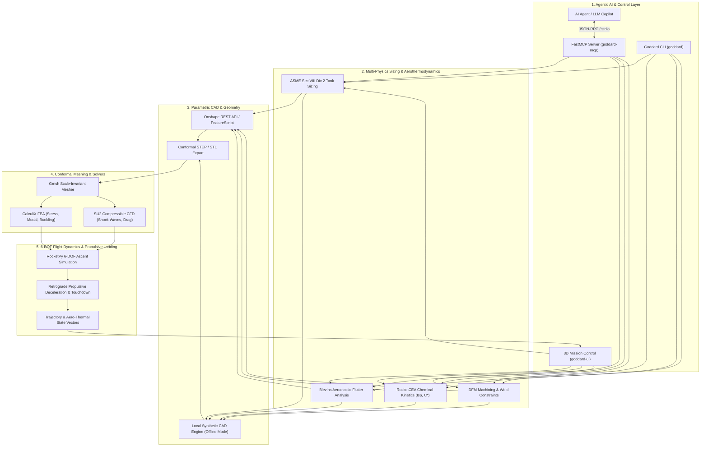

# Goddard: Multi-Physics Generative Rocket Design & CAD-to-Physics Copilot

[](https://github.com/tarunprakash2468/Goddard/actions/workflows/ci.yml)
[](https://www.python.org/)
[](https://opensource.org/licenses/Apache-2.0)
[](https://modelcontextprotocol.io/)
[](#system-architecture)

**Goddard** is an aerospace-grade, production multi-physics generative rocket design platform and CAD-to-Physics co-pilot. It bridges generative parametric CAD, closed-form multi-physics sizing, conformal scale-invariant FEA/CFD meshing, 6-DOF atmospheric trajectory flight dynamics with propulsive VTVL landing, and an interactive 3D WebGL Mission Control telemetry interface—all exposed to Autonomous Agents and LLMs via the Model Context Protocol (MCP).

---

## Key Capabilities

- **Parametric Cloud CAD Integration:** Native bidirectional binding with Onshape via REST APIs and FeatureScript for parametric airframe, tankage, and multi-engine thrust puck generation.
- **Analytical Aerospace Sizing Engine:**
  - **ASME Section VIII Div 2:** Thin- and thick-walled pressure vessel sizing with safety factor $\ge 1.5$ for cryogenic LOX, $LH_2$, and $LCH_4$ tanks.
  - **Blevins Aeroelastic Flutter:** Fin flutter and divergence boundary verification preventing structural breakup in transonic/supersonic regimes ($M \approx 0.8 - 4.5$).
  - **RocketCEA Thermochemistry:** Shifting/frozen equilibrium chemical kinetics, vacuum/sea-level specific impulse ($I_{sp}$), and characteristic velocity ($C^*$).
  - **Design for Manufacturing (DFM):** Min-wall machining limits, additive manufacturing overhang constraints, and weld-joint land sizing.
- **Scale-Invariant 3D Meshing (Gmsh):** Automated boundary layer extrusion, tetrahedral core meshing, surface curvature refinement, and conformal multi-volume meshing for external aerodynamics and internal fluid structures.
- **High-Fidelity Solvers (CalculiX & SU2):** Automated generation of CalculiX FEA input decks (`.inp`) for von Mises stress and buckling analysis, and SU2 compressible Navier-Stokes input decks (`.su2`) for transonic wave drag and shock formation.
- **6-DOF Ascent & Propulsive Landing (RocketPy):** Complete 6-DOF quaternion flight dynamics, variable mass inertia tensors, atmospheric wind shear models, stage separation dynamics, and retrograde propulsive VTVL touchdown burns.
- **Interactive 3D Mission Control:** FastAPI + Three.js + Chart.js web dashboard providing real-time 3D rocket geometry rendering, stress color-mapping, staging timelines, and flight telemetry plots.
- **Model Context Protocol (FastMCP):** First-class MCP server providing structured tools for AI agents to synthesize, size, simulate, and refine launch vehicles autonomously.

---

## System Architecture



---

## Supported Launch Vehicle Classes

| Class | Archetype | Mass Range | Propulsion / Propellants | Engine Architecture | Staging & Recovery |
| :--- | :--- | :--- | :--- | :--- | :--- |
| **Class I** | Suborbital Sounding Rocket | $100\text{ kg} - 2\text{ t}$ | Solid HTPB / APCP or Hydrocarbon Monopropellant | Single motor, fixed or gimballed nozzle | Parachute recovery / ballistic impact |
| **Class II** | Medium-Lift Orbital Launcher | $50\text{ t} - 600\text{ t}$ | Cryogenic LOX / Kerosene (RP-1) or LOX / Methane | 9-engine octagonal/octaweb cluster | 2-stage to LEO, RTLS propulsive landing with grid fins |
| **Class III**| Super Heavy Reusable Booster | $1,000\text{ t} - 5,000\text{ t}$| Sub-cooled Liquid $CH_4$ / Liquid $O_2$ | 33-engine concentric dual-ring cluster with differential gimbal | Fully reusable booster & starship, propulsive tower catch |

---

## Quickstart Guide

### 1. Installation

Requires Python 3.10, 3.11, or 3.12:

```bash
# Clone the repository
git clone https://github.com/tarunprakash/Goddard.git
cd Goddard

# Set up virtual environment
python3 -m venv .venv
source .venv/bin/activate  # On Windows: .venv\Scripts\activate

# Install Goddard in editable mode with development dependencies
pip install -e ".[dev]"
```

### 2. Environment Configuration

Copy the example environment file:

```bash
cp .env.example .env
```

Populate `.env` with your Onshape API credentials if using live cloud CAD:
```ini
ONSHAPE_ACCESS_KEY=your_key_here
ONSHAPE_SECRET_KEY=your_secret_here
ONSHAPE_DID=your_document_id
ONSHAPE_WID=your_workspace_id
ONSHAPE_EID=your_element_id
GODDARD_PORT=8050
GODDARD_OFFLINE_MODE=false
```

> **Note:** Set `GODDARD_OFFLINE_MODE=true` to run fully air-gapped without Onshape credentials. Goddard will synthesize geometric topologies locally.

---

## Usage

### Command Line Interface (CLI)

Goddard provides the `goddard` command-line tool for complete design synthesis, physics verification, and trajectory evaluation:

```bash
# Sizing and design synthesis for a Class II orbital launcher
goddard design --class orbital --payload 15000 --apogee 250000

# Run multi-physics structural and aeroelastic verification
goddard verify --design-id rev_001

# Execute 6-DOF ascent and propulsive landing simulation
goddard simulate --design-id rev_001 --landing-site ocean_barge

# Export design package (STEP, FEA deck, CFD deck, flight telemetry)
goddard export --design-id rev_001 --output ./artifacts/
```

### 3D Mission Control Dashboard

Launch the interactive real-time Mission Control UI:

```bash
goddard-ui
```
Navigate to `http://localhost:8050` in your browser. The dashboard delivers:
- **Interactive Three.js 3D Viewport:** Full orbit/pan/zoom inspection of synthesized rocket stages, interstages, engine bells, and fairing assemblies.
- **Structural Stress & Flutter Visualizer:** Color-coded stress gradients mapped across airframe bulkhead contours.
- **Flight Trajectory Deck:** Real-time altitude, velocity, dynamic pressure ($Q$), Mach number, and acceleration graphs powered by Chart.js.

### FastMCP Model Context Protocol Server

Integrate Goddard directly with AI agents (such as Claude Desktop, Gemini CLI, or custom autonomous copilots):

```bash
goddard-mcp
```

#### Claude Desktop Configuration (`claude_desktop_config.json`)
```json
{
  "mcpServers": {
    "goddard": {
      "command": "goddard-mcp",
      "env": {
        "GODDARD_OFFLINE_MODE": "true"
      }
    }
  }
}
```

The FastMCP server exposes tools including:
- `size_pressure_vessel`: Calculate wall thickness and burst pressure per ASME Sec VIII Div 2.
- `verify_fin_flutter`: Compute aeroelastic flutter boundary using Blevins/NACA formulations.
- `synthesize_vehicle`: Generate full geometric and structural specification for rocket stages.
- `run_flight_simulation`: Execute 6-DOF flight profile and return trajectory kinematics.

---

## Offline & Air-Gapped Simulation Mode

Goddard is designed to run in air-gapped engineering labs and CI pipelines without network connectivity or third-party CAD dependencies:
- Setting `GODDARD_OFFLINE_MODE=true` switches all CAD geometry pipelines to deterministic local synthetic solid modeling.
- The built-in mesh generation fallback creates valid `.msh` surfaces directly for testing solvers and visualization.
- Complete regression test suites run cleanly without external API keys.

---

## Testing & Verification

Goddard maintains aerospace-grade unit and integration test coverage:

```bash
# Run complete test suite
pytest tests/ -v

# Run with coverage report
pytest --cov=goddard tests/ -v

# Run Ruff linter and code format checks
ruff check .
ruff format --check .
```

---

## Contributing

We welcome contributions from aerospace engineers, numerical analysts, and software developers. Please review [CONTRIBUTING.md](CONTRIBUTING.md) for detailed guidelines on coding standards, physical units, and pull request verification.

---

## License

Goddard is open-source software licensed under the **Apache License, Version 2.0**. See the [LICENSE](LICENSE) file for complete details.
